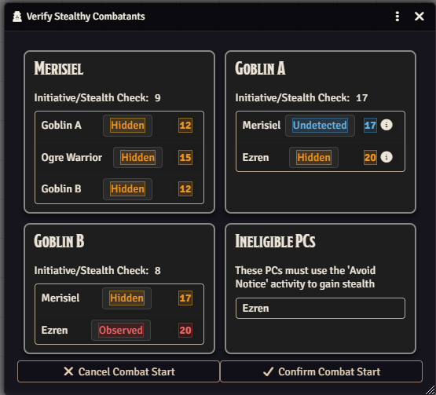

### PF2e Stealthy v1.2.0

- Opt-in setting for a Start Combat dialog. If enabled, and there are stealthy characters in the combat, a dialog will be presented when Start Combat is pressed that shows the GM those characters and allows them final control of the visibility states they will have vs each observer based on cover or whatever prior to the completion of Start Combat.
- Opt-out setting to disable listing target visibilities on initiative cards.
- improved criteria for showing prepare/clear ambush on the context menu.

[module](<https://foundryvtt.com/packages/pf2e-stealthy>) | [Github](<https://github.com/Eligarf/pf2e-stealthy>) | [Thread](<https://discord.com/channels/880968862240239708/1565811961839620346>)

